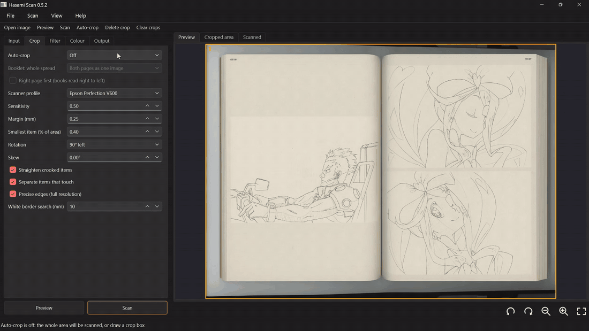

# Hasami Scan

*Hasami* (鋏) is Japanese for scissors.

Hasami Scan is a scanning app for Windows with smarter auto-crop. It is made
for anime material: artbooks, Blu-ray and DVD booklets, prints, shikishi and
trading cards.

- **Several items on the glass:** each print, card or photo becomes its own
  straightened file. White borders are kept. Dust, hairs and the scanner frame
  are ignored.
- **Open booklets:** you get only the page that is completely on the glass,
  from its outer edge to the spine, even when the booklet is too big for the
  bed. If the whole spread fits, you get both pages, or the spread as one
  image. Crops end at the top page's printed edge, without the striped edges of
  the pages underneath. A check box makes the right page come first, for books
  read right to left.
- **Works like VueScan:** Preview, adjust the crop boxes, Scan. The scan
  appears strip by strip as the scanner moves. There is a raw-file option, and
  turning the preview turns every saved scan.



> **AI disclosure:** Hasami Scan was created with the help of AI. Most of
> the code, tests and documentation were written by Anthropic's Claude
> (through Claude Code), directed by the maintainer and tested on real
> scanners and real scans. Review it as you would any other code before
> relying on it.

Questions, problems or scanner tuning requests:
[Discord](https://discord.gg/TAAV8B9WWg) or GitHub issues.

## Install (Windows)

1. Install your scanner's own driver first, for example Epson Scan from your
   model's support page on epson.com.
2. Download `HasamiScanSetup-<version>.exe` from
   [Releases](https://github.com/PetMyRock/hasami-scan/releases) and run it.
   It needs no Python and no admin rights. It installs to
   `%LOCALAPPDATA%\Programs\Hasami Scan` and adds a Start menu entry, an
   optional desktop icon and an uninstaller.
3. Windows may warn that the installer comes from an unknown publisher,
   because it is not signed yet: click **More info → Run anyway**.

TWAIN drivers work out of the box, 32-bit ones included (such as the old
EPSON Scan). The app picks the best connection to your scanner by itself;
**Input → Show all scanner connections** lists the others (WIA, VueScan's
TWAIN source). Settings are kept in `%APPDATA%\HasamiScan`.

**Updates:** once a day on start, the app asks GitHub whether a newer
version is out, and offers to download it (your settings are kept). Turn this
off under **Help → Check for updates on start**; **Help → Check for updates**
asks at once. Nothing is sent besides that request.

The install folder also has `hasami.exe`, the command line:
`hasami list`, `hasami diag` (a report on what the scanner driver offers,
with a small test scan).

## Supported scanners

Auto-crop is tuned on real scans with checked crops. How well it works depends
on the scanner's lid, light and edges, so each scanner model gets tuned
separately.

| Scanner | Status |
|---|---|
| **Epson Perfection V600** | Tuned: 57 real scans (booklet spreads, booklets too big for the bed, covers, prints), 26 scans of a thick artbook and 9 pages of an artbook with a thin page stack all crop correctly. |
| Epson Perfection V39 | Tuned on older scans (black bed and light lid). |
| Other scanners | They work with the default profile, but auto-crop is not tuned for them yet. |

Each tuned scanner model has its own **scanner profile** (the auto-crop's
tuned numbers and switches), picked automatically from the scanner's name:
tuning a new scanner never changes how the others crop. **Crop → Scanner
profile** chooses one by hand; the status bar shows which one is in use.

**Want your scanner tuned?** Ask on the project's
[Discord server](https://discord.gg/TAAV8B9WWg). You send a few scans (an empty bed, and items you actually
scan), the crops are checked by hand and auto-crop is tuned against them.
Scans you post there can be seen by the members of that channel; they are used only for testing and are not
published anywhere else.

**Test scan** (toolbar, Ctrl+T) makes such a scan in one click: the whole bed at
400 dpi, whatever the crops and scan resolution are, saved uncropped as a TIFF in its
own folder with its own file name (Output → Test scans). Press it when the
auto-crop gets something wrong, and send the file.

### Helping tune auto-crop

Turn on **Crop > Save my corrections as crop cases**. Whenever you fix an auto-crop box before scanning, Hasami
Scan keeps the preview, the scanned area (at most 400 dpi) and the boxes in a "crop case" (Documents/Hasami
Scan/Crop cases). **Scan > Save this case** keeps one when the crop was right. Nothing is uploaded: use **File >
Share crop cases...** to zip the cases you choose and post them in the tuning channel on the Discord server.
The members of that channel can see what you post; it is used only to tune auto-crop and is not published
anywhere else.

## Use

1. Put the item face down on the glass and close the lid.
2. Press **Preview**: a quick scan, with a crop box around each item.
3. Adjust the boxes if needed, then press **Scan**. Only the area around the
   boxes is scanned at full resolution, and each box is saved as a file.

Editing crop boxes:

- Drag inside a box to move it, and drag an edge or a corner to resize it.
- Booklet mode: while you drag an edge, the edges auto-crop found nearby show as thin lines, and the
  edge snaps to one when it comes within a few pixels. Hold Shift to drag freely.
- An amber edge with a **?** is one auto-crop was unsure about: hover over it to see why, and check it.
- Turn a box with the round handle above it, or type its angle under
  **Crop → Skew** (the arrow keys turn it by 0.1°).
- Drag on empty space to add a box; press Delete to remove one.

Moving around the preview:

- Mouse wheel or Ctrl+= / Ctrl+- to zoom, the right mouse button to pan, and
  **Fit** to see everything.
- **Rotate left / right** (Ctrl+[ / Ctrl+]) turns the preview, and every saved
  scan with it.

Settings are organised like VueScan's tabs:

- **Input:** scanner, colour mode, preview and scan resolution, 24 or 48-bit colour.
- **Crop:** auto-crop mode, booklet options, sensitivity, margin, rotation, skew.
- **Filter:** descreen (for the dot pattern of printed artbooks), dust removal, sharpening.
- **Colour:** levels, white balance, faded-colour restore, negatives.
- **Output:** folder, file name, JPEG/PNG/TIFF/WebP/PDF, raw file, test scans.

| Auto-crop mode | Use for |
|---|---|
| **Every item (multi)** | Several prints, cards or photos on the glass. Each one becomes a file. |
| **One item (single)** | One document, cover or page. |
| **Booklet page** | An open booklet: only the page that is fully on the glass, or both pages (or the spread as one image) when the whole spread fits. |
| **Off** | The whole scan, or boxes you draw yourself. |

**Raw files** (Output → Raw file) save each crop exactly as the scanner
delivered it: no levels, white balance or other colour processing, as a TIFF
at the scanner's bit depth. To apply the colour settings to one later:
`hasami crop scan0001_raw.tif --crop off --out processed/`.

The **Cropped area** tab shows the selected crop box straightened and with
the colour settings applied: a quick check made from the preview.

## How auto-crop works

Detection runs on a downscaled copy (about 1000 px on the long side). The
edges are then refined on the full-resolution scan.

- **Lid model.** The lid's colour is learnt from the image border, and a smooth lighting surface is fitted to it, including lids that darken towards the edges of the glass.
- **Foreground.** Colour distance from the lid is combined with long edges. Specks are removed and the scanner-frame strip is cleared.
- **Separating items.** Touching items are split along the narrow necks between them.
- **Rectangle fit.** A rotated rectangle is fitted with projection profiles, so a protruding hair or corner does not enlarge it.
- **White borders.** Each side is searched outward for a print's white border, which is often the same colour as the lid.
- **Precise edges.** Each side is placed with sub-pixel accuracy on the full-resolution scan.

**Booklet mode** is a separate code path:

1. **The visible booklet.** It is found first. On a light lid its sides are pulled in to the paper edges: a thick booklet props the lid up, and the shadows this leaves would otherwise join the booklet.
2. **Which side runs off the bed.** The booklet touches the image border there, or its paper edges carry on to the border.
3. **The spine.** It is found from several cues:
   - the paper outline notching where the pages meet;
   - the gutter shadow;
   - a seam running the full height of the page;
   - a crease line;
   - the blank band between the text blocks.
4. **The top page's edges.** Each page is cut at its top page's printed edge. Layer lines found along each side tell the edges of the pages underneath (the page stack) from the top page.
5. **Thick books on a light lid.** They are fitted as a whole spread.

## Limitations

- **White paper on a white lid at the edge of the glass.** When a page runs off the bed and its last few millimetres are blank, booklet mode cannot always tell it from the lid.
- **Dark pages with a lighter page stack.** A navy page whose stack is lighter than the page keeps that stack band.
- **Very pale prints on a white lid.** Only part of the print may be found.
- **Flat booklets.** A booklet pressed perfectly flat, with art across the gutter and no shading, has no visible spine; booklet mode then guesses from the layout.
- **Native drivers.** VueScan drives some scanners over USB with its own drivers. Hasami Scan uses the scanner maker's TWAIN or WIA driver, so it gets that driver's speed and colour processing.

## Scanner connections

| Connection | Devices | Status |
|---|---|---|
| TWAIN | Windows scanners with a TWAIN driver, 32 and 64-bit | Used daily with an Epson V600 (old EPSON Scan driver) |
| WIA | Windows scanners with a WIA driver | Works, but with WIA's limits (no live view; the V600 stops at 1200 dpi) |
| eSCL / AirScan | Network scanners (recent HP, Canon, Epson, Brother) | Tested against a simulated scanner |
| SANE | Linux and macOS | Tested with SANE's test device |

## Working on the code

You need Python 3.10 or newer (64-bit) and Git.

```bat
git clone https://github.com/PetMyRock/hasami-scan.git
cd hasami-scan
DevSetup.bat
```

`DevSetup.bat` makes a `.venv`, installs the app in editable mode with the
test tools, and runs the tests. Run the app with `.venv\Scripts\hasami-scan`
and the command line with `.venv\Scripts\hasami`. 32-bit TWAIN drivers need a
32-bit Python with `pytwain` (`py -3-32 -m pip install pytwain==2.3.0`): the
app finds it through the `py` launcher, or set it under **Input → TWAIN:
Python to use**.

On other systems: `pip install -e ".[gui,dev]"` (add `sane` for SANE scanners
and `discovery` to find network scanners).

- **Tests:** `pytest`, about 3 minutes. They use generated scans with known
  crops.
- **Benchmarks:** `python benchmarks/synthetic_autocrop.py` and
  `python benchmarks/synthetic_booklet.py`.
- **Installer:** `python packaging/build.py --python32 <32-bit Python>` (see
  the top of that file). Pushing a version tag (`v0.5.0`) makes GitHub Actions
  build it and attach it to a release.

`CLAUDE.md` holds the project notes used when working with Claude Code.

## Licence

Copyright (c) 2026 PetMyRock.

Hasami Scan is released under the **MIT License** (see `LICENSE`): use,
change, share or sell it, for any purpose, as long as the copyright notice and
the licence text stay with it.

The libraries it uses keep their own licences: PySide6/Qt (LGPL-3.0), OpenCV (Apache-2.0),
NumPy and Pillow; their licence texts ship with the installer.
